<div align="center">

# 💸 Gestion de la trésorerie des associations

**Une application de trésorerie pensée pour le droit tunisien des associations : budget, journal, factures, reçus, registres légaux et déclaration fiscale mensuelle, avec la pièce justificative attachée à chaque écriture.**


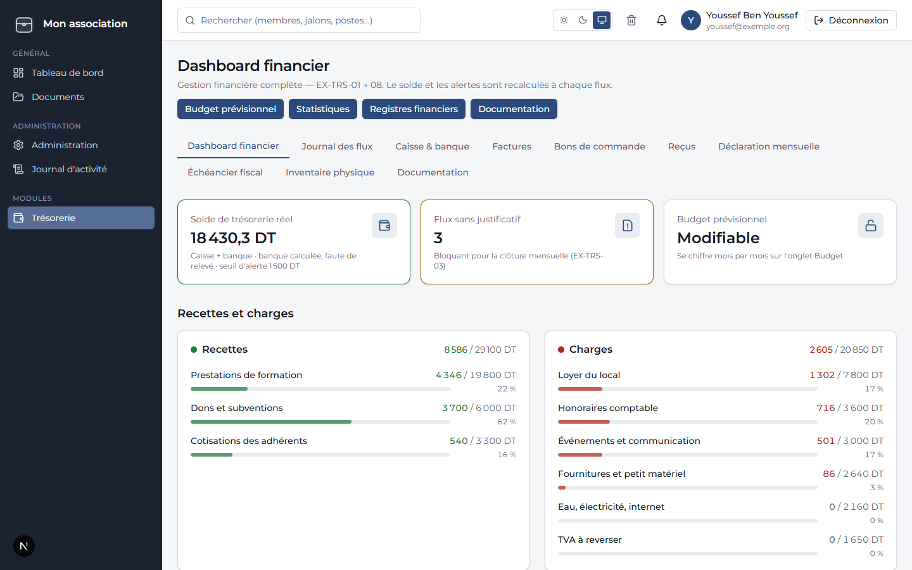

</div>

---

## ⚖️ Conçue pour le cadre légal tunisien

Une association tunisienne ne tient pas ses comptes comme une entreprise : elle répond au **décret-loi n° 2011-88 du 24 septembre 2011 portant organisation des associations**, à la fiscalité tunisienne (TVA, timbre fiscal, retenue à la source) et aux obligations de transparence sur l'origine de ses fonds. L'application encode ces règles **dans le code**, avec des tests, plutôt que dans la tête du trésorier.

| Exigence | Ce que fait l'application |
|---|---|
| **Registre des dons** (décret-loi 2011-88) | Chaque don est typé : **numéraire ou en nature**, **origine publique ou privée**, **provenance nationale ou étrangère**. Le CIN du donateur est exigé pour un don en numéraire et signalé s'il manque. Les pièces attendues (reçu du donateur, convention de don, courrier d'engagement) se déposent sur la fiche. |
| **Reçus** pour cotisations, dons et encaissements | **Numérotation continue, sans trou**, avec les mentions exigées par le décret-loi 2011-88. Familles de reçus paramétrables, modèles éditables. |
| **Plafond des paiements en espèces** | Un règlement ou un encaissement de plus de **500 DT** en espèces est signalé : au-delà, le décret-loi impose le chèque ou le virement. |
| **Six registres légaux** | Clients, créances, **cotisations**, **dons**, fournisseurs (matricule fiscal vérifié avant tout engagement), chèques et dettes. |
| **Déclaration mensuelle** | **TVA collectée et déductible**, crédit reporté d'un mois sur l'autre, **timbres fiscaux** encaissés et **retenue à la source** opérée, le tout liquidé dans l'ordre des mois. Un mois sans activité se déclare en déclaration néant. |
| **Retenue à la source** | Taux par type de prestataire (honoraires au régime réel ou forfaitaire, loyers d'immeubles, marchés, location d'hôtel), seuil de **1 000 DT**, **certificat de retenue** à remettre au prestataire. |
| **Facturation** | TVA à **19 %**, **timbre fiscal de 1 DT**, numérotation continue par exercice, échéance, et **avoirs** : une facture émise ne se modifie pas, elle se corrige par un avoir. |
| **Traçabilité et sérieux comptable** | Journal d'activité horodaté et nommé, corbeille restaurable 30 jours (rien n'est supprimé sèchement), budget voté **verrouillé après l'assemblée générale** et corrigé par demande tracée, conservation des preuves de dépôt. |

> Les taux et seuils fiscaux sont corrects au moment de l'écriture et **paramétrables** : ce sont des valeurs de droit, à vérifier à chaque loi de finances. L'application est une aide à la tenue des comptes et ne remplace pas un expert-comptable.

## 🌟 Points forts

- **Déclaration fiscale mensuelle automatisée** : le trésorier saisit ses factures émises et reçues, l'application liquide la TVA, les timbres et la retenue à la source, puis **clôture et génère le document**.
- **Éditeur de documents personnalisable** : factures, reçus, devis, avoirs et bons de commande se **posent à la souris**, avec des **champs préremplis** entre accolades (`{{client}}`, `{{reference}}`, `{{totalTTC}}`…) remplis à l'émission. L'aperçu est un **vrai PDF**, avec police embarquée.
- **Import de modèles existants** : déposez un `.xlsx`, un `.pptx` ou un `.docx`, l'application en lit la mise en page et en fait un modèle retouchable.
- **Gestion des reçus et des cotisations** : un encaissement donne droit à un reçu numéroté, la cotisation de chaque adhérent est suivie membre par membre, à jour ou en attente.
- **Pilotage en continu** : solde de trésorerie réel (caisse et banque, le relevé bancaire fait foi), seuil d'alerte, budget prévisionnel mois par mois, suivi réel contre prévu, calendrier des échéances fiscales avec rappels à J-7.
- **Sécurité et rôles** : administrateur, trésorier et lecteur (président, commissaire aux comptes), mots de passe hachés, et un **test automatique qui échoue si une action serveur n'est pas protégée**.

## 🖼️ Captures

**Tableau de bord financier** : solde réel, alertes, recettes et charges contre le budget.


**Déclaration fiscale mensuelle** : TVA collectée et déductible, timbres, retenue à la source, factures reçues et certificats de retenue.

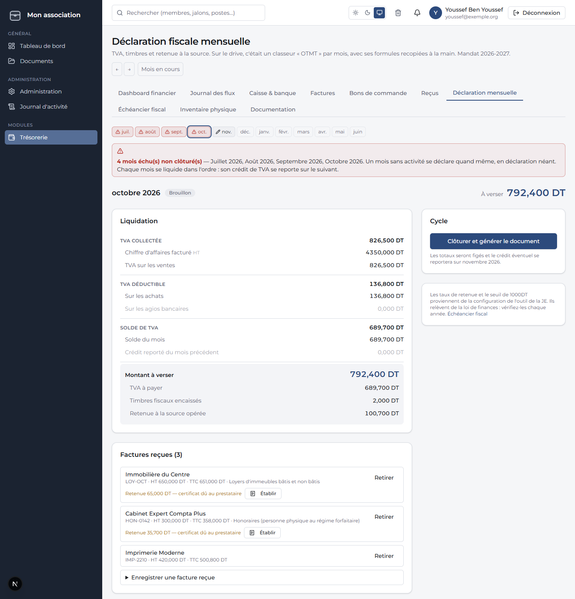

**Éditeur de documents** : une facture personnalisable avec champs préremplis, blocs, tableau et totaux.

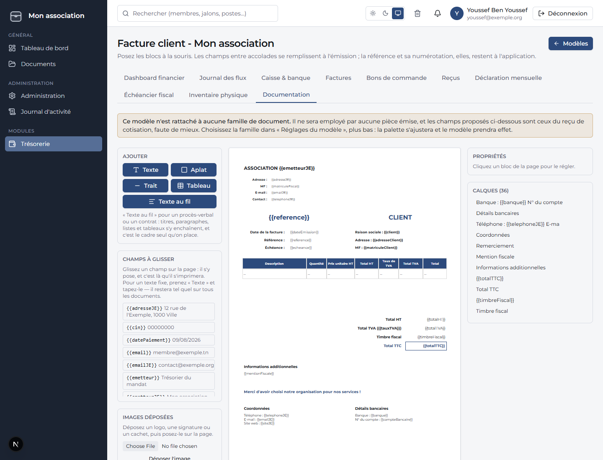

<table>
  <tr>
    <td width="50%"><b>Registre des dons</b> (décret-loi 2011-88)<br>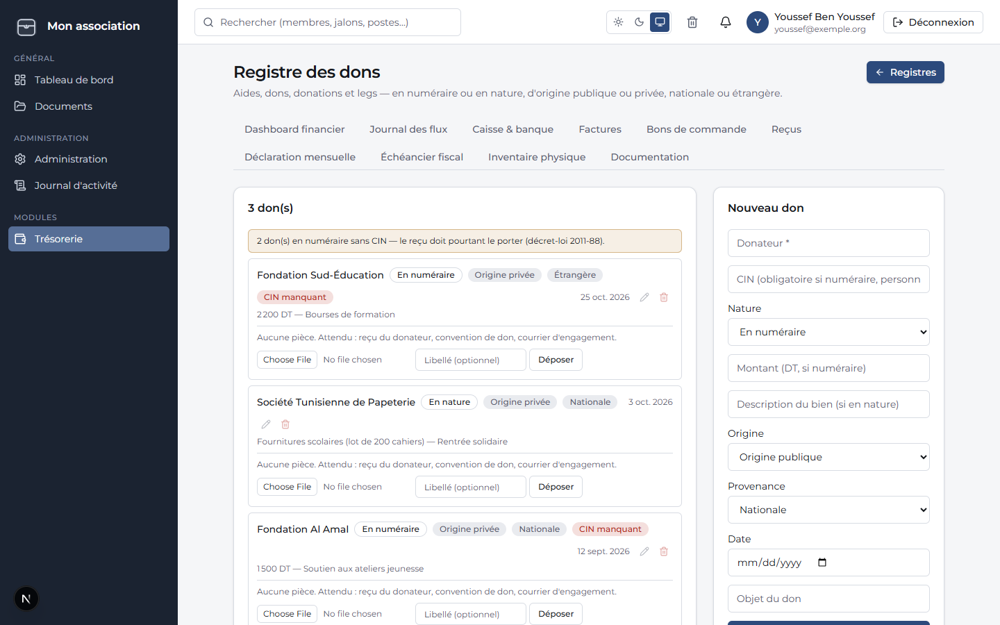</td>
    <td width="50%"><b>Factures et avoirs</b><br>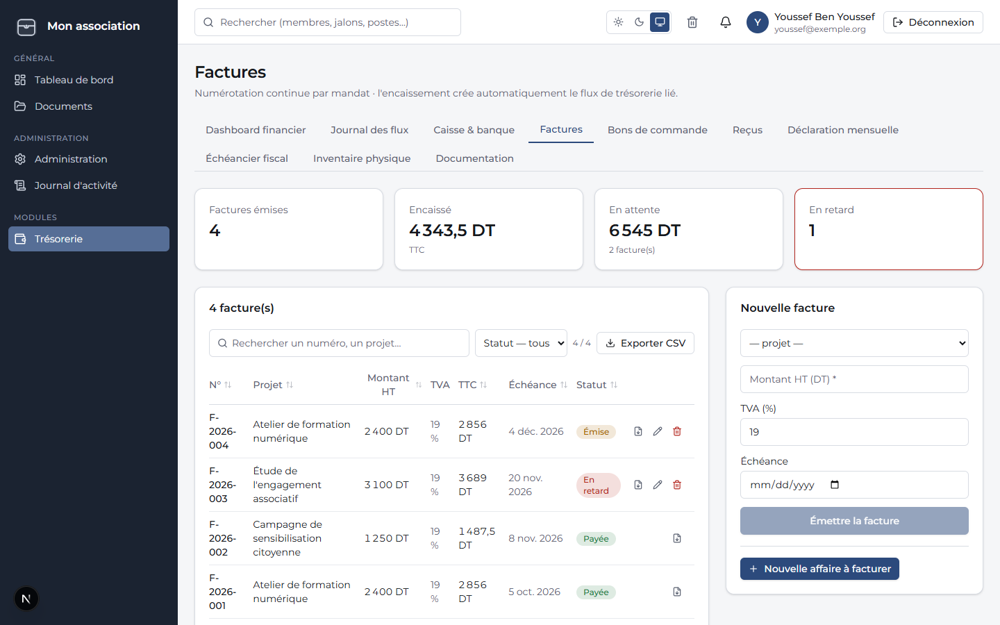</td>
  </tr>
  <tr>
    <td><b>Reçus numérotés</b><br>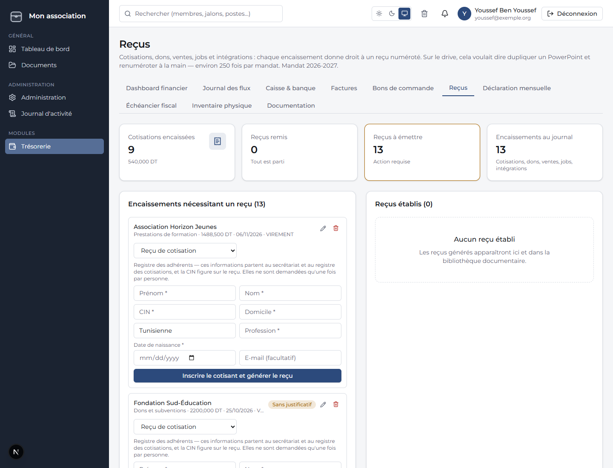</td>
    <td><b>Registre des cotisations</b><br>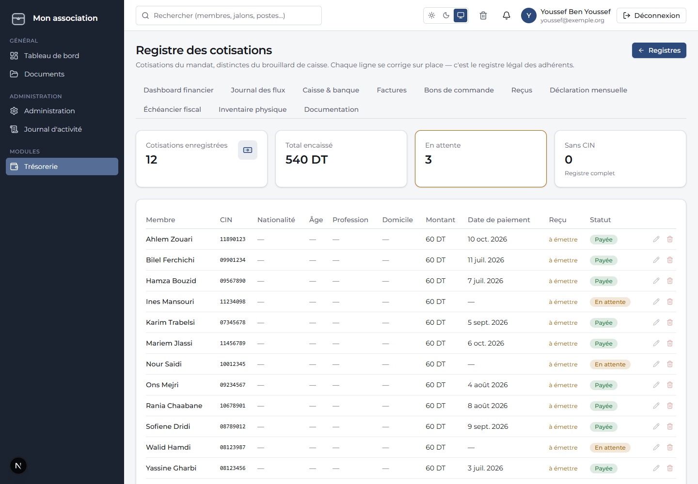</td>
  </tr>
  <tr>
    <td><b>Budget prévisionnel</b><br>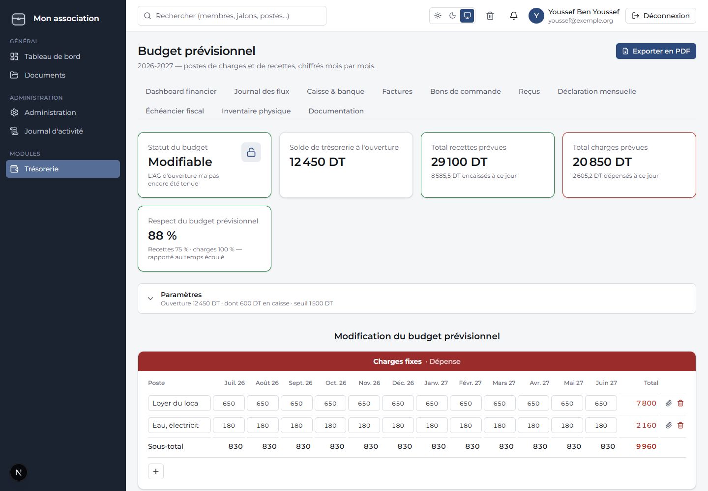</td>
    <td><b>Journal des flux</b><br>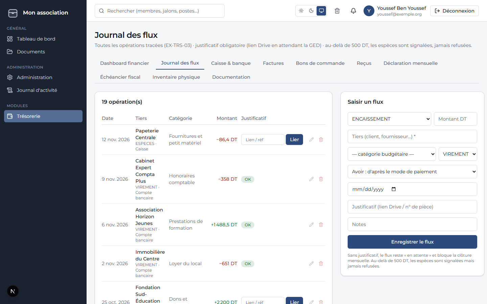</td>
  </tr>
  <tr>
    <td><b>Registres légaux</b><br>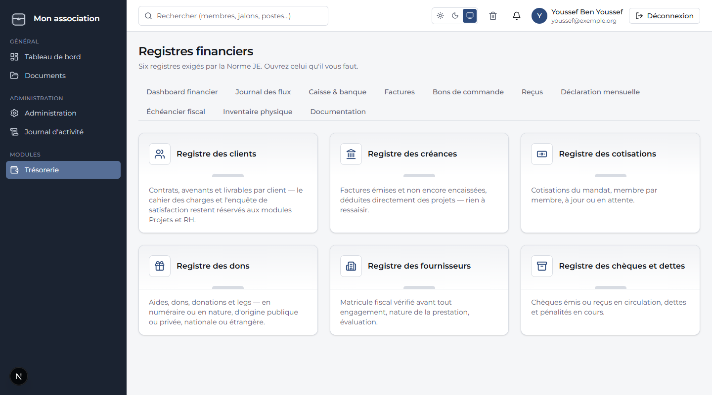</td>
    <td><b>Catalogue des modèles de documents</b><br>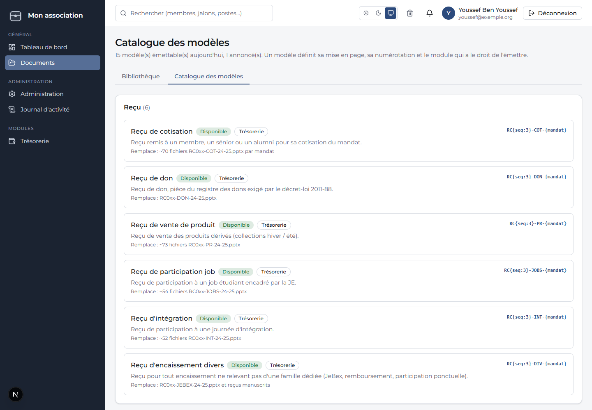</td>
  </tr>
</table>

*Données de démonstration fictives (association, clients, donateurs et montants inventés).*

## 🧭 Sommaire technique

1. [D'où vient ce projet](#doù-vient-ce-projet)
2. [Ce que fait l'application](#ce-que-fait-lapplication)
3. [Mise en route](#mise-en-route)
4. [Où sont stockées les données](#où-sont-stockées-les-données)
5. [Comptes et rôles](#comptes-et-rôles)
6. [Architecture](#architecture)
7. [Scripts](#scripts)
8. [Couleurs](#couleurs)
9. [Diagrammes](#diagrammes)
10. [Conventions de développement](#conventions-de-développement)
11. [Ce qui reste à faire](#ce-qui-reste-à-faire)

L'application tourne **sur un poste** comme **en ligne** : c'est la même application, seule la ligne de connexion à la base change.

---

## D'où vient ce projet

Créé à la suite de mon parcours en tant que président fondateur d'une association, après avoir assuré la trésorerie durant les premiers mois suivant sa création et consacré plus d'un an à l'étude de la fiscalité et du cadre juridique régissant les associations.

Ce projet a été conçu dans le but d'être mis gratuitement à la disposition des associations tunisiennes. Il est toujours en cours de développement et n'a pas encore été testé dans son intégralité.

La licence restera en attente jusqu'à la finalisation complète du projet.

---

## Ce que fait l'application

### Prévoir

- **Budget prévisionnel** par exercice, en sections (recettes, dépenses de fonctionnement, investissements), avec ventilation mensuelle.
- **Verrouillage après l'assemblée générale d'ouverture** : un budget voté ne se modifie plus librement ; il se corrige par une demande tracée.
- **Suivi réel contre prévu**, poste par poste.

### Enregistrer

- **Journal des opérations** : encaissements et décaissements, par compte (caisse / banque), avec mode de paiement et pièce justificative.
- **Caisse et banque** : soldes séparés, mouvements internes (retraits, versements), rapprochement avec le relevé bancaire — le relevé fait foi dès qu'il y en a un.
- **Seuil de trésorerie minimal** et alerte quand on passe dessous.

### Facturer et encaisser

- **Affaires** : un client, un projet, un montant convenu. Créés en un geste depuis la trésorerie ; le client entre au registre du même mouvement.
- **Factures** : numérotation continue par exercice, TVA, timbre fiscal, échéance, reste à facturer calculé depuis le montant convenu.
- **Avoirs** : une facture émise ne se modifie pas, elle se corrige par un avoir ; les deux pièces restent au registre.
- **Bons de commande** et engagement budgétaire.

### Justifier

- **Reçus** pour les encaissements, les cotisations et les dons, numérotés sans trou, avec les mentions exigées par le décret-loi 2011-88.
- **Familles de reçus** paramétrables, modèles de documents éditables.
- **Moteur de documents** : gabarits et canevas, import de modèles existants (XLSX, DOCX, PPTX), charte graphique, PDF avec police embarquée.

### Tenir les registres

Clients et créances, cotisations, dons, fournisseurs, chèques et dettes, inventaire et amortissements.

### Déclarer

- **Déclaration mensuelle** : TVA collectée et déductible, retenues à la source, timbre fiscal.
- **Certificats de retenue à la source**.
- **Calendrier des obligations fiscales**, avec rappels.

### Et, en toile de fond

- **Corbeille** : rien n'est supprimé sèchement, tout est restaurable 30 jours.
- **Journal d'activité** : chaque écriture nommée et horodatée.
- **Mode clair et mode sombre**, au choix ou selon le système.

---

## Mise en route

Il faut **Node.js 20 ou plus**. Rien d'autre à installer.

```bash
npm install
```

```bash
cp .env.example .env.local
```

Ouvrez `.env.local` et renseignez :

- `MONGODB_URI` — voir [Où sont stockées les données](#où-sont-stockées-les-données) ;
- `AUTH_SECRET` — générez-le avec `npx auth secret` ;
- `SEED_ADMIN_EMAIL`, `SEED_ADMIN_NOM`, `SEED_ADMIN_PASSWORD` — le premier
  compte (mot de passe d'au moins 12 caractères, à changer à la première
  connexion).

Démarrez la base, si vous l'avez choisie locale — **laissez cette fenêtre
ouverte** :

```bash
npm run base:locale
```

Créez l'exercice et le premier compte :

```bash
npm run seed
```

Lancez l'application :

```bash
npm run dev
```

Puis ouvrez http://localhost:3000 et connectez-vous avec l'adresse et le mot
de passe du `.env.local`.

> **Rien à l'écran ?** `npm run etat` dit si la base répond et ce qu'elle
> contient. L'écran de connexion affiche lui aussi un avertissement explicite
> quand la base est injoignable, plutôt qu'un « identifiants invalides »
> trompeur.

---

## Où sont stockées les données

Une seule ligne décide : `MONGODB_URI` dans `.env.local`. Trois façons de
l'obtenir.

### A. En local, sans rien installer

```bash
npm run base:locale
```

Télécharge une fois un vrai serveur MongoDB (~100 Mo), puis le démarre. Les
données sont écrites dans `.donnees/mongo`, à la racine du projet, et **ne
quittent jamais le poste**. Arrêter le script n'efface rien.

```
MONGODB_URI="mongodb://127.0.0.1:27018/tresorerie"
```

### B. En local, avec Docker

```bash
docker compose up -d
```

```
MONGODB_URI="mongodb://127.0.0.1:27017/tresorerie"
```

Les données vivent dans le volume `donnees-mongo`. `docker compose down` ne
les supprime pas ; `down -v`, si.

### C. En ligne

MongoDB Atlas, offre gratuite M0 : *Cluster → Connect → Drivers*, puis copiez
la chaîne de connexion.

```
MONGODB_URI="mongodb+srv://<user>:<mot-de-passe>@<cluster>.mongodb.net/tresorerie?retryWrites=true&w=majority"
```

C'est l'option à choisir si plusieurs personnes tiennent les comptes depuis
des postes différents, ou pour que les sauvegardes soient gérées sans vous.

### Passer de l'un à l'autre

Changer `MONGODB_URI` **ne déplace pas les données** : l'application se
connecte simplement ailleurs, et trouve une base vide. Pour emporter
l'existant, exportez puis réimportez :

```bash
mongodump --uri="<ancienne-uri>" --out=sauvegarde
```

```bash
mongorestore --uri="<nouvelle-uri>" sauvegarde/tresorerie
```

C'est aussi la commande à retenir pour **sauvegarder** : une comptabilité sans
sauvegarde est une comptabilité qu'on peut perdre.

---

## Comptes et rôles

L'authentification se fait par **e-mail et mot de passe**, stockés hachés
(bcrypt). Aucun fournisseur externe : l'application doit rester disponible le
soir d'une assemblée générale.

| Rôle | Ce qu'il peut faire |
| --- | --- |
| **Administrateur** | Tout, plus la gestion des comptes et le paramétrage. |
| **Trésorier** | Tient les comptes : écritures, pièces, registres, déclarations. |
| **Lecteur** | Consulte sans rien modifier — président, commissaire aux comptes, vérificateur. |

Trois garde-fous :

- un compte n'est **jamais supprimé**, seulement désactivé — le journal doit
  continuer de nommer l'auteur d'une écriture après un départ ;
- on ne peut **pas se désactiver soi-même**, ni se retirer son propre rôle
  d'administrateur : l'application se retrouverait sans personne pour
  l'administrer ;
- le **mot de passe n'est jamais lu**, seulement remplacé, et n'apparaît dans
  aucun journal.

Les comptes se gèrent dans **Administration › Comptes**.

---

## Architecture

Application **Next.js 16** (App Router), TypeScript, Tailwind v4, MongoDB via
Mongoose. Architecture en trois couches logiques, déploiement monolithique.

```
src/
  app/              écrans (App Router) et routes d'API
    (app)/          l'application authentifiée
    login/          écran de connexion
  modules/
    base/models/    socle : exercice, compte, membre, client, projet, cotisation
    core/           droits, journal, corbeille, paramétrage, navigation, thème
    documents/      moteur de documents : catalogue, modèles, rendu, PDF
    tresorerie/     tout le métier comptable
  components/ui/    briques d'interface partagées
  lib/              connexion base, gardes d'autorisation, utilitaires
tests/
  contrats/         contrats des modèles, des documents, frontière client
  securite/         balayage statique des gardes de permission
scripts/            amorçage, base locale, diagnostic, diagrammes
```

Dans chaque module :

| Dossier | Rôle |
| --- | --- |
| `models/` | Un fichier par modèle Mongoose, jamais plusieurs dans `index.ts`. |
| `services/` | **Logique pure et testée** : calculs, règles, formats. Aucune I/O. |
| `actions/` | Server Actions : garde de permission, validation Zod, écriture, journal. |
| `components/` | Composants client propres au module. |

La règle qui tient le reste : **le calcul est dans `services/`, pas dans
l'action ni dans l'écran.** C'est ce qui permet de le tester sans base de
données — les 602 tests tournent en quelques secondes, sans MongoDB.

### Droits d'accès

Matrice définie **en code** (`src/modules/core/rbac.ts`), versionnée et hors
de portée d'une modification accidentelle en production. Les comptes reçoivent
des rôles ; les permissions d'un rôle ne changent qu'à cet endroit.

Un test de sécurité balaie toutes les Server Actions du dépôt et échoue si
l'une d'elles n'appelle pas de garde — avec une liste d'exceptions qui doivent
chacune porter leur justification écrite.

---

## Scripts

| Commande | Ce qu'elle fait |
| --- | --- |
| `npm run dev` | Serveur de développement sur le port 3000. |
| `npm run build` | Build de production. |
| `npm start` | Sert le build de production. |
| `npm run base:locale` | Démarre MongoDB sur ce poste (option A). |
| `npm run seed` | Crée l'exercice en cours et le premier compte. |
| `npm run etat` | Diagnostic : la base répond-elle, que contient-elle. |
| `npm run compte:test` | Crée (ou retire avec `-- --supprimer`) un compte de test. |
| `npm run typecheck` | Vérification des types. |
| `npm run lint` | ESLint. |
| `npm test` | Toute la suite de tests. |
| `npm run test:unit` | Tests unitaires des services. |
| `npm run test:contrats` | Contrats des modèles, des documents et de la frontière client. |
| `npm run test:securite` | Gardes de permission des Server Actions. |
| `npm run verif` | Types, lint et tests d'affilée — à lancer avant de livrer. |
| `npm run verif:cibles <fichiers>` | Vérification des types sur quelques fichiers, en cours de frappe. |

---

## Couleurs

La couleur de la structure se saisit dans **Administration › Paramétrage ›
Apparence**, en hexadécimal. Elle habille les boutons, les liens et la barre
latérale, et sert de couleur par défaut aux documents émis et aux e-mails.
Le thème sombre l'éclaircit tout seul : on ne règle qu'une valeur.

Sans rien saisir, l'application sort en **bleu d'encre** (`#2c4a7c`) — neutre,
et assez éloigné du vert « encaissé », de l'ambre « à surveiller » et du rouge
« en retard » pour ne jamais se confondre avec un état de la comptabilité. Ces
trois couleurs-là ne changent jamais : elles disent un fait comptable, pas une
marque.

Pour changer le **défaut** livré plutôt que le réglage d'une installation :
`COULEUR_PRIMAIRE_DEFAUT` dans `src/modules/core/apparence.ts` et
`--primary-base` dans `src/app/globals.css`. Les deux doivent rester
identiques — `tests/contrats/couleurs.test.ts` échoue sinon.

---

## Diagrammes

`docs/diagrammes/Tresorerie.drawio` — 9 pages, à ouvrir sur
[app.diagrams.net](https://app.diagrams.net) ou dans l'extension draw.io :
diagrammes de classes (vue d'ensemble puis un par module) et cas
d'utilisation par rôle.

Ils ne sont **pas dessinés à la main** : ils sont extraits du code par les
trois scripts de `scripts/diagrammes/`. Après toute évolution d'un schéma,
régénérez-les — un diagramme faux est pire qu'un diagramme absent.

---

## Conventions de développement

Elles ne sont pas décoratives : chacune vient d'un problème rencontré.

1. **Le calcul vit dans `services/`**, en fonctions pures, et il est testé.
2. **Un refus se rend, il ne se jette pas.** Les actions d'écriture renvoient
   `{ ok, message }` ; un refus métier (« cet exercice existe déjà ») est une
   information pour la personne qui saisit, pas une page d'erreur.
3. **Toute écriture est journalisée**, avec son auteur et ce qui a changé.
4. **Rien n'est supprimé sèchement** : tout passe par la corbeille, restaurable
   30 jours, et la restauration repasse par les mêmes règles que l'écriture.
5. **Chaque entité porte son exercice** (`mandat`), directement ou par son
   parent — sinon elle réapparaît dans les écrans de l'exercice suivant. Un
   test de contrat le vérifie, exceptions justifiées à l'appui.
6. **Chaque modèle nomme sa collection** explicitement : sans cela, renommer
   un modèle déplacerait silencieusement les données.
7. **Le mois de bascule d'exercice est écrit une seule fois**
   (`MOIS_DEBUT_EXERCICE` dans `core/services/mandat.ts`). Une association qui
   suit l'année civile change ce seul chiffre.
8. **Aucune couleur de marque en dur.** Tout passe par les tokens de
   `globals.css`, qui dérivent de `--primary-base`. Un `#rrggbb` écrit dans
   un composant est une couleur que la structure ne pourra pas changer.
9. **Aucun secret dans le dépôt.** Les scripts lisent l'environnement et
   refusent de démarrer sans, plutôt que de retomber sur une valeur par défaut.

---

## Ce qui reste à faire

- **Version bureau.** L'application est prévue pour être empaquetée ensuite en
  application de bureau ; rien dans le code ne s'y oppose — elle tourne déjà
  entièrement en local, base comprise.
- **Sauvegarde intégrée.** Aujourd'hui `mongodump` à la main ; un bouton
  « exporter la comptabilité » serait plus sûr pour qui ne vit pas dans un
  terminal.
- **Clôture d'exercice.** L'application sait ouvrir et archiver un exercice ;
  le report automatique des soldes d'un exercice sur le suivant reste à
  écrire.
- **Taux et seuils fiscaux.** Ils sont corrects pour la Tunisie au moment de
  l'écriture et paramétrables, mais ce sont des valeurs de droit : à
  reverifier à chaque loi de finances.

---

## Licence

© 2026 Youssef Ben Youssef. Tous droits réservés (voir [LICENSE](LICENSE)). Le code est publié pour consultation et évaluation ; toute réutilisation exige l'accord écrit de l'auteur.
